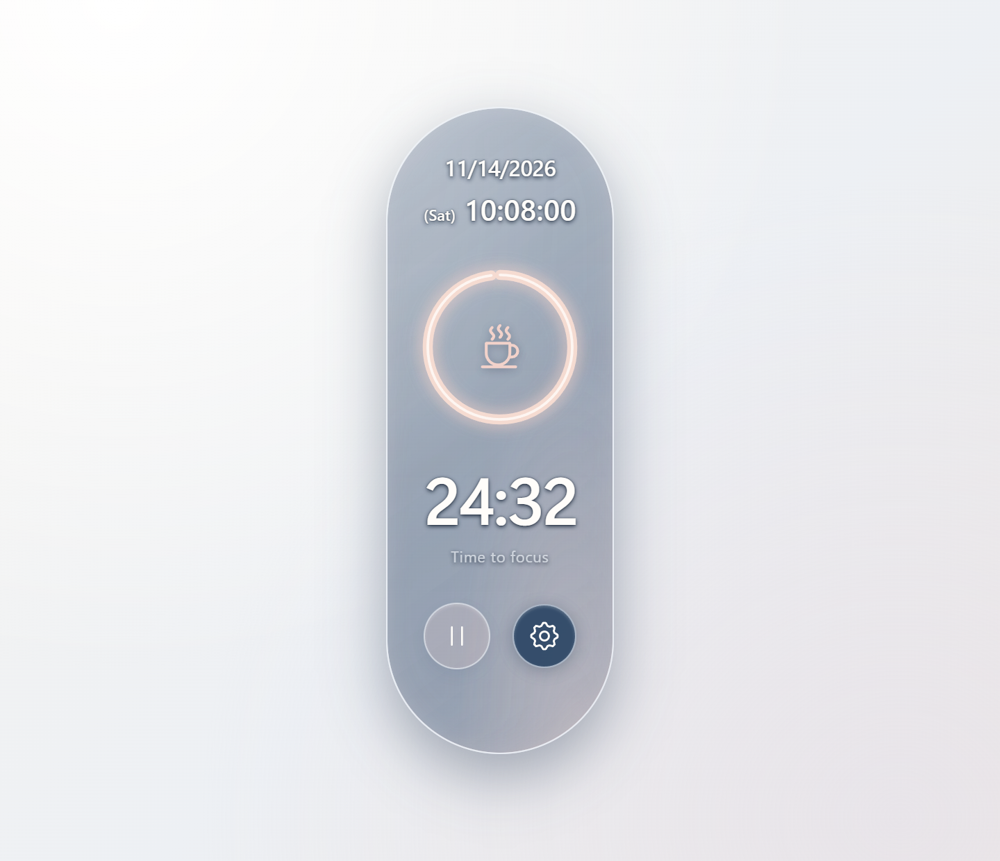
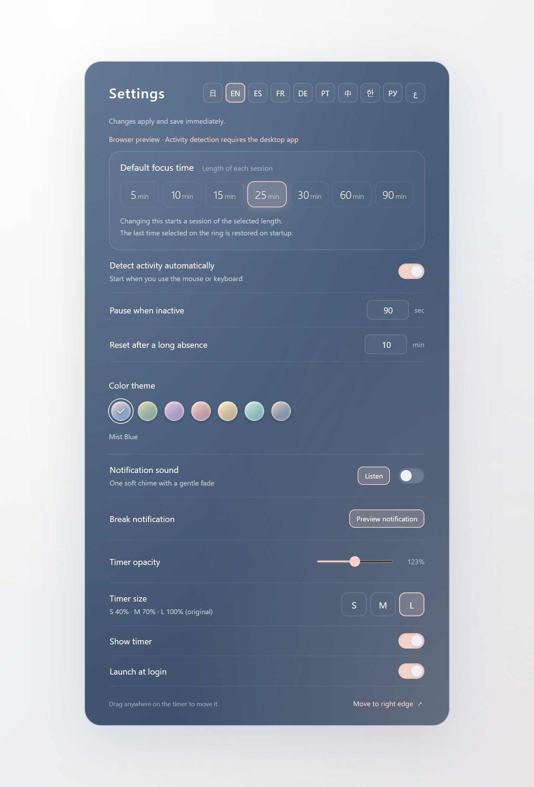

# ☕ ADHD Coffee Time

**The timer you don’t have to remember.**

Automatically starts when you work. Pauses when you’re away. Reminds you to rest.

| Windows | macOS | Linux |
| :---: | :---: | :---: |
|  |   |  |

[All releases](https://github.com/sourcekatsudon/ADHDCoffeeTimer/releases) · [Platform status and limitations](docs/PLATFORMS.md)

English · [日本語](docs/readme/ja.md) · [简体中文](docs/readme/zh-CN.md) · [한국어](docs/readme/ko.md) · [Español](docs/readme/es.md) · [Français](docs/readme/fr.md) · [Deutsch](docs/readme/de.md) · [Português (Brasil)](docs/readme/pt-BR.md) · [Русский](docs/readme/ru.md) · [العربية](docs/readme/ar.md)

*Browser preview with CSS glass styling. Native backdrop effects vary by operating system and desktop settings; these images are not native macOS validation.*

## Why this exists

I have ADHD. I bought a physical Pomodoro timer. I forgot to start it. So I built a timer that starts itself.

## What it does

- Starts and resumes from operating-system activity when automatic detection is enabled.
- Pauses after **90 seconds** without input and resets after **10 minutes** away by default. Both thresholds are adjustable.
- Offers **5, 10, 15, 25, 30, 60, and 90 minute** presets, with manual pause and reset controls.
- Shows a break reminder, with an optional sound. Sound is off by default.
- Includes **seven themes**, adjustable opacity, and **S / M / L** sizes at **40% / 70% / 100%**. Preferences survive a restart.
- Stays in the system tray or menu bar, with an optional start-at-login setting.
- Provides **10 interface languages**: Japanese, English, Spanish, French, German, Portuguese, Simplified Chinese, Korean, Russian, and Arabic.

| Timer | Settings | Break reminder |
| :---: | :---: | :---: |
|  |  |  |

*Browser previews; native glass and window appearance may differ.*

## Install

**Windows:** run the x64 installer above. It is unsigned; SmartScreen may warn.

**Mac:** choose Apple Silicon (M-series) or Intel. Open the DMG and drag the app to Applications. Requires macOS 11+. These ad-hoc signed builds are **not notarized**; macOS may block first launch. See [installation help and verification limits](docs/PLATFORMS.md).

**Linux:** not available; activity detection is incomplete.

Open Settings to choose your language, theme, size and login behavior. Use the tray/menu bar to quit.

## Your work stays yours

Local only: no accounts, telemetry or cloud. The app reads input age, never keystroke content. Settings stay on your computer. This is a reminder tool, not a medical treatment.

## Build or contribute

[Build from source](docs/BUILDING.md) · [Report a bug](https://github.com/sourcekatsudon/ADHDCoffeeTimer/issues) · [Platform status](docs/PLATFORMS.md) · [MIT License](LICENSE) · [Third-party notices](THIRD-PARTY-NOTICES.md)
