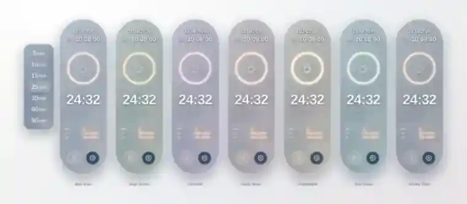
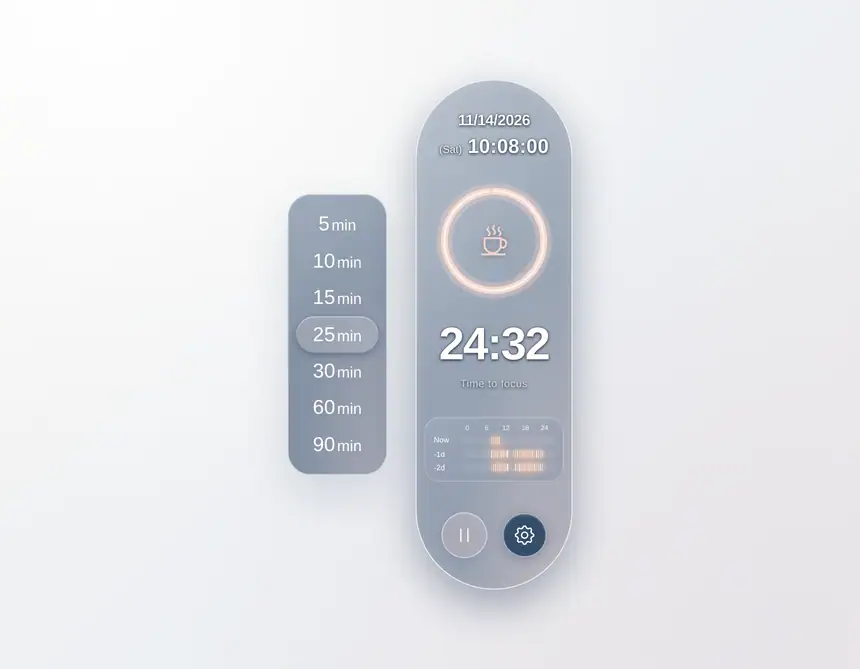
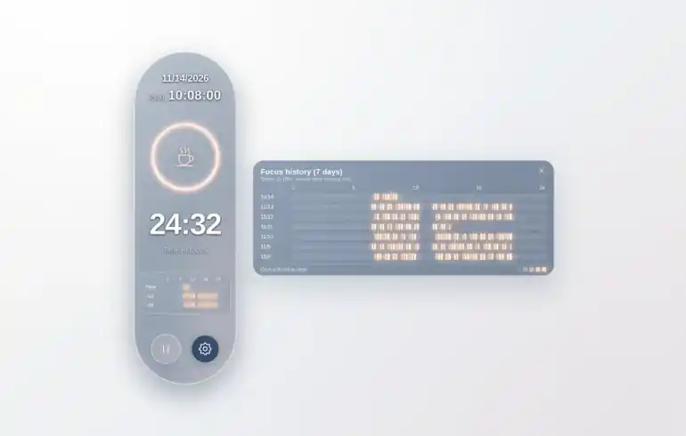

# ☕ ADHD Coffee Time

**A timer for people who forget timers.**

Automatically starts when you work. Pauses when you’re away. Reminds you to rest. **Now with actual focus-time history and optional Google-account sync across PCs.**

| Windows | macOS | Linux |
| :---: | :---: | :---: |
|  |   |  |

[All releases](https://github.com/sourcekatsudon/ADHDCoffeeTimer/releases) · [v0.2.0 release notes](docs/releases/v0.2.0.md) · [Platform status and limitations](docs/PLATFORMS.md)

English · [日本語](docs/readme/ja.md) · [简体中文](docs/readme/zh-CN.md) · [한국어](docs/readme/ko.md) · [Español](docs/readme/es.md) · [Français](docs/readme/fr.md) · [Deutsch](docs/readme/de.md) · [Português (Brasil)](docs/readme/pt-BR.md) · [Русский](docs/readme/ru.md) · [العربية](docs/readme/ar.md)

*Real UI browser previews. Native glass effects vary by OS; these are not Mac hardware tests.*

## Why this exists

I'm impatient. I bought a physical Pomodoro timer, but starting it every time felt like one step too many. So I built a timer that starts itself.

## What it does

- **Automatic focus timer:** starts with PC activity, pauses after **90 seconds** away, and resets after **10 minutes** (adjustable).
- **5, 10, 15, 25, 30, 60, 90 minute** presets, a timer-selection popup, and manual pause/reset.
- **Actual focus-time tracking:** records only seconds when the timer is running, excluding paused/idle time. Shows the most recent **3 days** on the timer and a detailed **7-day** history popup with **15-minute cells**. Click a lit cell to clear it.
- **Gentle completion reward:** finishing a timer highlights its history cell. Focus recording, display, and reward can all be disabled in Settings.
- **Optional multi-PC sync:** sign in with Google on the [Focus dashboard](https://adhd-coffee-focus.vercel.app), pair each computer with a one-time code, and merge focus history from multiple computers. The website shows **7 or 30 days**; updated desktop software retains up to **32 days** locally.
- Break reminders with a soft optional chime, off by default.
- **Seven pastel themes**, opacity, **S/M/L (40%/70%/100%)**, and **10 languages**.
- Tray/menu-bar residency, optional login startup, and saved preferences.

## Screenshots

| Timer with time preset popup | Timer with focus history popup |
| :---: | :---: |
|  |  |

| Timer | Settings | Break reminder |
| :---: | :---: | :---: |
|  |  |  |

*Screenshots are browser previews rendered from the real application UI; focus-history cells contain illustrative data. Native glass and window appearance can vary by OS.*

## Install

**Windows:** run the x64 `.exe`. It is unsigned; SmartScreen may warn.

**Mac:** choose Apple Silicon (M-series) or Intel, open the DMG, and drag the app to Applications. macOS 11+. Ad-hoc signed, **not notarized**; first launch may be blocked. [Installation help and verification limits](docs/PLATFORMS.md).

**Linux:** unavailable; activity detection is incomplete.

Use Settings to personalize the app; quit from the tray/menu bar.

## Your work stays yours

Local-first: no account or cloud connection is required to use the timer, and there is no telemetry. The app reads only time since the last OS input, **not keystroke content**. Settings and focus records are stored locally. Cloud sync is **opt-in** and uploads aggregated 15-minute activity records only after each PC is paired with your Google account. Disconnecting stops future uploads; previously synced data may remain. This is a reminder tool, not a medical treatment.

**Desktop v0.2.0:** Includes the focus-history and optional Google-account sync features described above. If upgrading from v0.1.0, install the new Windows or macOS package; old work history cannot be reconstructed retrospectively.

## Build or contribute

[Build from source](docs/BUILDING.md) · [Report a bug](https://github.com/sourcekatsudon/ADHDCoffeeTimer/issues) · [Platform status](docs/PLATFORMS.md) · [MIT License](LICENSE) · [Third-party notices](THIRD-PARTY-NOTICES.md)

## Connect multiple PCs (opt in)

1. Open the [Focus dashboard](https://adhd-coffee-focus.vercel.app) and sign in with Google.
2. Get a **single-use 16-character pairing code**, valid for 10 minutes.
3. On each PC, open **Settings → Cloud sync** and connect using a fresh pairing code.
4. Use **Sync now** or let the PC automatically sync about every **30 minutes**. The website combines paired-device activity into **7-day or 30-day** history.

Local focus history remains available offline. When multiple PCs are used at the same time, aggregated 15-minute bins are approximate. Turning off focus history also pauses uploads. See the [backend and privacy documentation](web/README.md) and [developer API](web/API.md).

## Low-power design

The native timer advances in the OS-backed engine, emits a small 1 Hz timer tick, and refreshes history less frequently. The timer ring avoids continuous animation. CPU use of **0.6% on M2** is an engineering target, **not a verified benchmark**.
