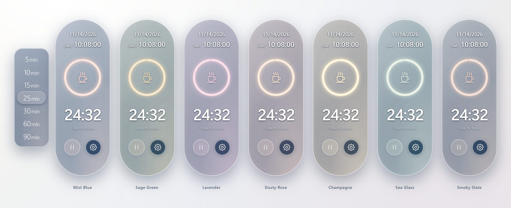
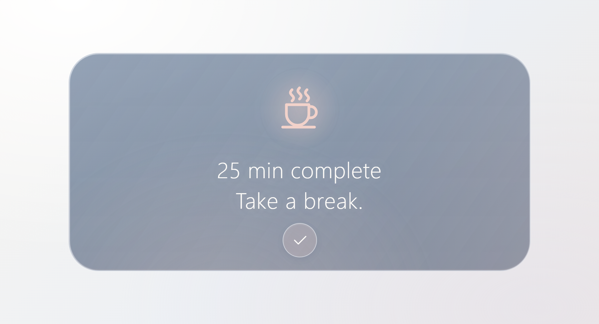

# ☕ ADHD Coffee Time

**A timer for people who forget timers.**

Automatically starts when you work. Pauses when you’re away. Reminds you to rest.

| Windows | macOS | Linux |
| :---: | :---: | :---: |
|  |   |  |

[All releases](https://github.com/sourcekatsudon/ADHDCoffeeTimer/releases) · [Platform status and limitations](docs/PLATFORMS.md)

English · [日本語](docs/readme/ja.md) · [简体中文](docs/readme/zh-CN.md) · [한국어](docs/readme/ko.md) · [Español](docs/readme/es.md) · [Français](docs/readme/fr.md) · [Deutsch](docs/readme/de.md) · [Português (Brasil)](docs/readme/pt-BR.md) · [Русский](docs/readme/ru.md) · [العربية](docs/readme/ar.md)

*Real UI browser previews. Native glass effects vary by OS; these are not Mac hardware tests.*

## Why this exists

I have ADHD. I bought a physical Pomodoro timer. I forgot to start it. So I built a timer that starts itself.

## What it does

- Starts with PC activity. Pauses after **90 seconds** away; resets after **10 minutes** (adjustable).
- **5, 10, 15, 25, 30, 60, 90 minute** presets and manual pause/reset.
- Break reminders with a soft optional chime, off by default.
- **Seven pastel themes**, opacity, **S/M/L (40%/70%/100%)**, and **10 languages**.
- Tray/menu-bar residency, optional login startup, and saved preferences.

| Timer | Settings | Break reminder |
| :---: | :---: | :---: |
|  |  |  |

*Browser previews; native glass and window appearance may differ.*

## Install

**Windows:** run the x64 `.exe`. It is unsigned; SmartScreen may warn.

**Mac:** choose Apple Silicon (M-series) or Intel, open the DMG, and drag the app to Applications. macOS 11+. Ad-hoc signed, **not notarized**; first launch may be blocked. [Installation help and verification limits](docs/PLATFORMS.md).

**Linux:** unavailable; activity detection is incomplete.

Use Settings to personalize the app; quit from the tray/menu bar.

## Your work stays yours

Local only: no accounts, telemetry or cloud. Reads input age, never keystroke content. Settings stay on your computer. A reminder tool, not a medical treatment.

## Build or contribute

[Build from source](docs/BUILDING.md) · [Report a bug](https://github.com/sourcekatsudon/ADHDCoffeeTimer/issues) · [Platform status](docs/PLATFORMS.md) · [MIT License](LICENSE) · [Third-party notices](THIRD-PARTY-NOTICES.md)
