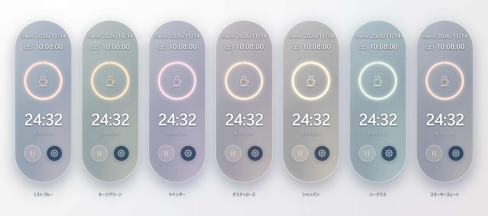
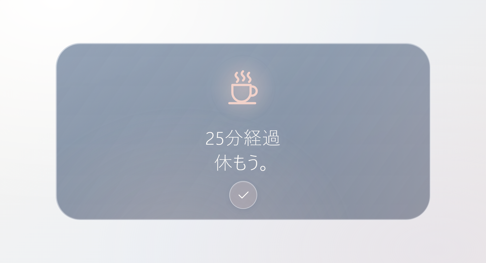

# ☕ ADHD Coffee Time

[English](../../README.md) · [日本語](ja.md) · [简体中文](zh-CN.md) · [한국어](ko.md) · [Español](es.md) · [Français](fr.md) · [Deutsch](de.md) · [Português (Brasil)](pt-BR.md) · [Русский](ru.md) · [العربية](ar.md)

**セットすることを、覚えていなくていいタイマー。**

PCを使うと自動でスタート。離席すると一時停止。休憩の時間をお知らせします。

ADHDの私は、休憩を忘れないために物理ポモドーロタイマーを買った。しかし、今度はタイマーをセットすること自体を忘れた。だから、PCを操作するだけで勝手に始まるタイマーを作った。

初期設定では、入力が90秒途絶えると一時停止し、10分離席するとリセットします。時間は5・10・15・25・30・60・90分から選択。7色のテーマ、透明度、通知音、S／M／L（40%／70%／100%）を調整でき、設定は次回起動時にも引き継がれます。10言語に対応し、トレイ／メニューバーに常駐します。

## ダウンロード・使い方

[Windows x64](https://github.com/sourcekatsudon/ADHDCoffeeTimer/releases/latest/download/ADHD-Coffee-Time_0.1.0_windows-x64-setup.exe) · [macOS Apple Silicon](https://github.com/sourcekatsudon/ADHDCoffeeTimer/releases/latest/download/ADHD-Coffee-Time_0.1.0_macos-arm64.dmg) · [macOS Intel](https://github.com/sourcekatsudon/ADHDCoffeeTimer/releases/latest/download/ADHD-Coffee-Time_0.1.0_macos-x64.dmg)

Windowsはexeを実行。Macはチップに合うDMGを開き、Applicationsへドラッグしてください。Mac版は未署名またはアドホック署名で、公証されていません。ネイティブMac UIの手動検証も未実施です。Linux版は利用できません。[対応状況](../PLATFORMS.md#linux)をご確認ください。

アカウント不要。データはローカルに保存し、テレメトリーはありません。取得するのはOSの最終入力からの経過時間で、入力内容は記録しません。医療・治療を目的としたアプリではありません。

| タイマー | 設定 | 休憩のお知らせ |
| :---: | :---: | :---: |
|  |  |  |

*画像はCSSでガラス表現を再現したブラウザプレビューです。実際の背景効果はOSや設定で異なります。*

[詳しい説明（英語）](../../README.md) · [ソースからビルド](../BUILDING.md) · [MITライセンス](../../LICENSE)
