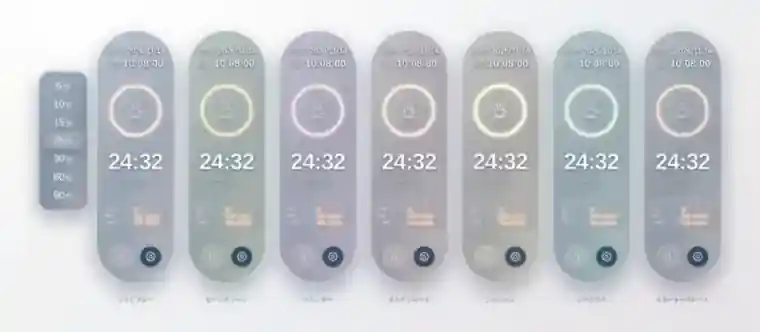
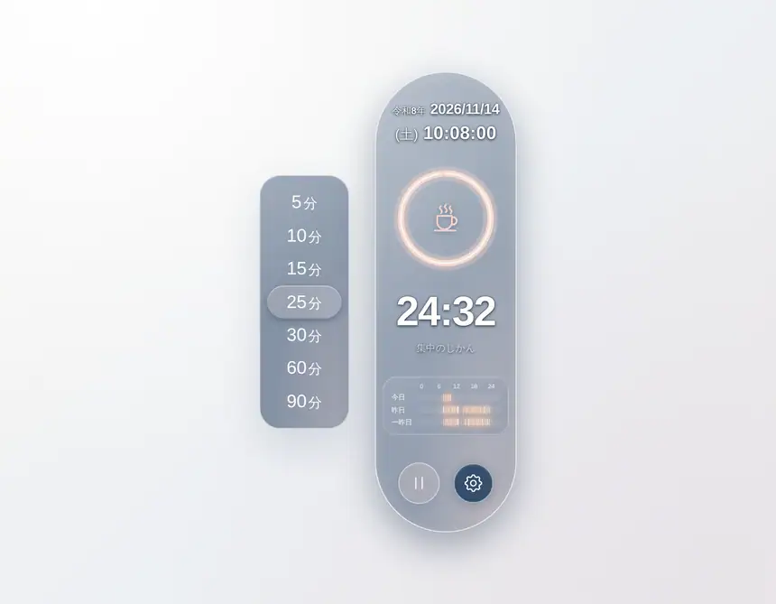
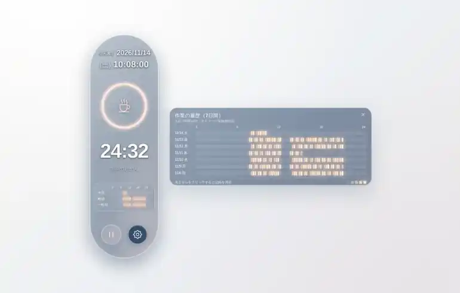
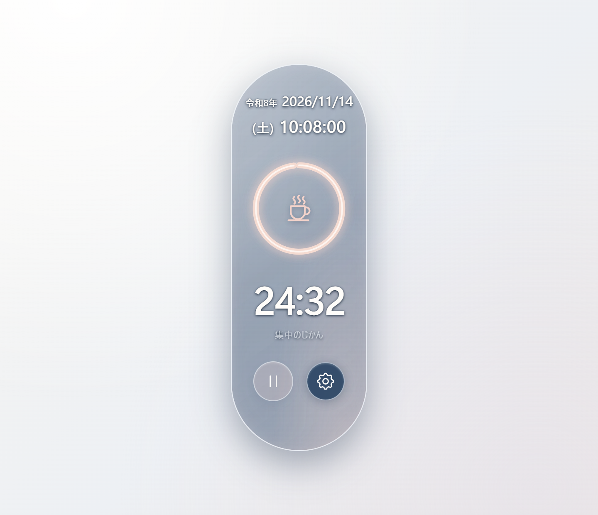
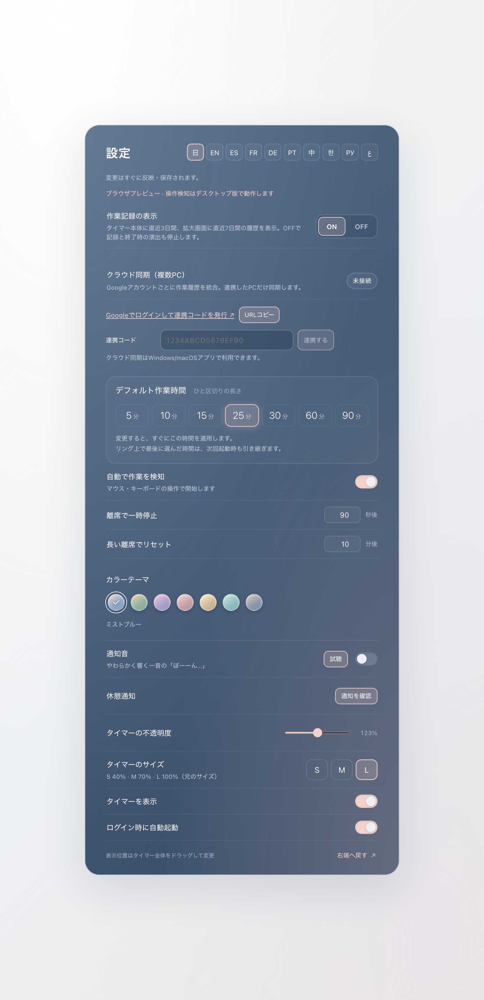

# ☕ ADHD Coffee Time

[English](../../README.md) · [日本語](ja.md) · [简体中文](zh-CN.md) · [한국어](ko.md) · [Español](es.md) · [Français](fr.md) · [Deutsch](de.md) · [Português (Brasil)](pt-BR.md) · [Русский](ru.md) · [العربية](ar.md)

**タイマーを忘れる人向けのタイマー**

PCを使うと自動でスタート。離席すると一時停止。休憩の時間をお知らせします。

私はせっかちなので、物理ポモドーロタイマーを買ったものの、毎回セットするのが面倒だった。だから、PCを操作するだけで勝手に始まるタイマーを作った。

初期設定では、入力が90秒途絶えると一時停止し、10分離席するとリセットします。時間は5・10・15・25・30・60・90分から選択。7色のテーマ、透明度、通知音、S／M／L（40%／70%／100%）を調整でき、設定は次回起動時にも引き継がれます。10言語に対応し、トレイ／メニューバーに常駐します。

## 新機能：実稼働時間の自動記録・複数PC同期

- **実際の稼働秒数を記録**。タイマーが動いている時間のみを対象とし、離席・一時停止中は加算しません。
- タイマーに**直近3日間**の小さな作業履歴、ポップアップに**直近7日間**の15分単位の履歴を表示。光っているセルはクリックして削除できます。
- タイマー完了時は該当セルを控えめにハイライト。設定で履歴の記録・表示をOFFにできます。
- **Googleログイン・複数PC同期は任意**。[Webダッシュボード](https://adhd-coffee-focus.vercel.app)でログインして16文字のワンタイム連携コードを発行し、各PCの「設定 → クラウド同期」で接続。約30分ごとに自動同期し、Webでは**7日間／30日間**の履歴を確認できます。更新版PCアプリのローカル保存期間は最大32日間です。
- 複数PCを同時利用した場合、同じ15分枠の合計は概算です。

**v0.2.0で正式対応：** 作業履歴の自動記録・Googleログインによる任意の複数PC同期をWindows/macOS版に追加しました。v0.1.0からは新しいインストーラーを導入してください。旧版で記録していなかった稼働履歴は後から復元できません。

## ダウンロード・使い方

[Windows x64](https://github.com/sourcekatsudon/ADHDCoffeeTimer/releases/latest/download/ADHD-Coffee-Time_0.2.0_windows-x64-setup.exe) · [macOS Apple Silicon](https://github.com/sourcekatsudon/ADHDCoffeeTimer/releases/latest/download/ADHD-Coffee-Time_0.2.0_macos-arm64.dmg) · [macOS Intel](https://github.com/sourcekatsudon/ADHDCoffeeTimer/releases/latest/download/ADHD-Coffee-Time_0.2.0_macos-x64.dmg)

Windowsはexeを実行。Macはチップに合うDMGを開き、Applicationsへドラッグしてください。Mac版は未署名またはアドホック署名で、公証されていません。ネイティブMac UIの手動検証も未実施です。Linux版は利用できません。[対応状況](../PLATFORMS.md#linux)をご確認ください。

アカウント連携しなくてもローカルで使用でき、テレメトリーはありません。取得するのはOSの最終入力からの経過時間で、**入力内容は記録しません**。クラウドへの作業履歴送信はPCを明示的に連携した場合のみ行います。連携解除後も過去の同期済み記録はクラウドに残る場合があります。医療・治療を目的としたアプリではありません。

| タイマー＋時間選択ポップアップ | タイマー＋作業履歴ポップアップ |
| :---: | :---: |
|  |  |

| タイマー | 設定 | 休憩のお知らせ |
| :---: | :---: | :---: |
|  |  |  |

*画像は実際のアプリUIをブラウザで描画したプレビューです。作業履歴のセルは説明用のサンプルデータです。実際の背景効果はOSや設定で異なります。*

[詳しい説明（英語）](../../README.md) · [ソースからビルド](../BUILDING.md) · [MITライセンス](../../LICENSE)
